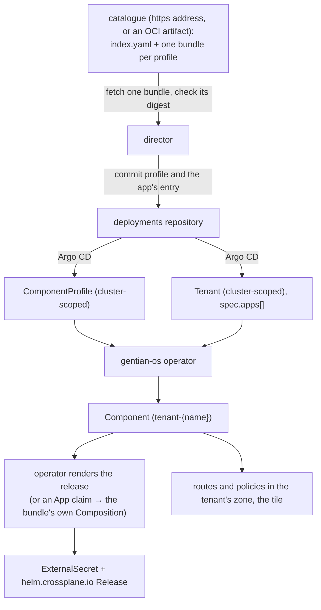

# App Catalog, Profiles and Integrations

**Companion to:** [architecture.md](../overview/architecture.md), [custom-catalogs.md](../guides/custom-catalogs.md), [store-contract.md](store-contract.md), [app-customization.md](../guides/app-customization.md)

---

## 1. The Catalog Model

Four kinds matter for an app. Two are authored (`ComponentProfile`, `Tenant`);
two are made by the operator (`Component`, `IntegrationBinding`).



- A **catalog** is an https address that serves static files: an `index.yaml`
  and one profile bundle per app. Nothing is copied from it into a cluster
  ahead of an install. One whose profiles must not be public is an OCI
  artifact holding the same files, read with the credential of a repository
  its owner declared; never a directory of the deployments repository, which
  holds the cluster's state only. Format, the three ways a catalog is added to a cluster
  and the commands are in [custom-catalogs.md](../guides/custom-catalogs.md).
- An **install** names an entry and the digest of its bundle. The director
  fetches that one file, refuses it unless the bytes hash to the digest and
  pass the bundle checks, and commits it under
  `clusters/<cluster>/catalogue/` together with the app's entry in
  `Tenant.spec.apps`. Installs come from the App Store app or from
  `kubectl gentian apps install`; no screen of the cluster lists a catalog
  ([store-contract.md](store-contract.md) §3, §9).
- The operator makes one **`Component`** per entry of `spec.apps`, in the
  tenant's namespace. The Component is what the release, the routes, the tile,
  the approved privileges and the published addresses hang off.

Kernel and system services (Keycloak, OpenFGA, PostgreSQL, the gateway, …)
are deployed by Argo CD from `kernel/`, not from a catalog. The desktop, the
administration console and the concierge are components too, from profiles
the operator chart ships; the App Store app is one from the store's catalog,
placed by the installer as one of the store's extra services
([store-contract.md §6](store-contract.md)).

---

## 2. Trust Model & Roles

| Actor | Writes | Effect |
|---|---|---|
| **Platform team** | `gentian-os`: Compositions, XRDs, admission policy, the profiles the chart ships | Defines the install pipeline |
| **Catalog publisher** | The files a catalog serves | Decides what a bundle says; cannot change which bytes an install pinned |
| **Cluster administrator** | The Cluster claim: catalogs for every tenant or for one, delegation to a tenant (`can_configure`) | Decides which catalogs exist on the cluster |
| **Tenant administrator** | `Tenant.spec.apps`, through the director (`can_install_app`); the tenant's own catalogs where delegated | Chooses profiles and builds; cannot edit a `ComponentProfile` |
| **Member** | Nothing | Uses installed apps |

**A catalog is not trusted.** What protects a cluster is the digest and the
checks on a bundle, not who serves it ([custom-catalogs.md](../guides/custom-catalogs.md) §7):

- The digest covers the whole bundle. The director checks it at fetch; the
  operator checks again at rollout, for a Component pinned to a digest, that
  the profile and its companions on the cluster are what the bundle says.
- A bundle may hold a short list of kinds beside its profile (a Composition,
  an `OIDCPackCatalog`, ConfigMaps, `Customization` records). Only a catalog
  of the whole cluster may bring any of them; a bundle from a tenant's own
  catalog is its profile and nothing else.
- A profile from a tenant's own catalog is installable only in that tenant,
  and never takes a name another origin holds.
- The names the platform answers on (`desktop`, `admin`, `store`, …) are
  refused to every profile but the platform's own ([routing.md §3.1](routing.md)).

### 2.1 Threat scenarios

| Scenario | Impact | What limits it |
|---|---|---|
| A catalog serves a harmful chart or image | Runs in the tenants that install it | Tenant namespace isolation, pod security and network policy ([security/design.md](../security/design.md)). The digest pins the profile, not the chart or images it names |
| A cluster-wide catalog serves a harmful Composition | A Composition is trusted as the platform's own | Only the cluster's administrator adds such a catalog; adding it is that decision |
| A profile asks for more than it needs | Larger blast radius | Everything permissive in a profile is a request: privileges, public addresses and `clientAuthorization: app` take effect only once a named person approved them on the tenant |
| A profile takes another's name or host | A page people mistake for the platform's | Origin rules and reserved host labels, above |
| Secrets in Helm values | Credential leak | Secrets reach a release through an ExternalSecret, not through `Release.spec.values` |

---

## 3. ComponentProfile — the Catalog Entry

Says what a component **is**: how it is deployed, what it needs from the
platform, what it offers other apps, and what it exposes.

```yaml
apiVersion: gentianos.io/v1alpha1
kind: ComponentProfile
metadata:
  name: openproject-ce            # cluster-scoped; the file name in the catalog
  labels:
    gentianos.io/profile-name: openproject-ce
spec:
  classes: [app]                  # service | app | shared-app
  launch: tile                    # tile | from | none
  trustTier: certified            # platform | certified | experimental
  version: "1.0.0"                # the entry's version, not upstream's

  package:
    chart:
      repository: "https://charts.openproject.org/"
      name: openproject
      version: "12.0.0"
    valueMapping:                 # which chart key receives which platform value
      database: { hostKey: "postgresql.connection.host", passwordKey: "postgresql.auth.password" }
      s3:       { endpointKey: "s3.endpoint", bucketKey: "s3.bucketName" }
    extraValues:                  # fixed chart values
      fullnameOverride: "openproject-ce"

  requires:
    services:
      identity:                   # exactly one of oidc | saml | sidecar (iam.md §1.11)
        sidecar: { entryPaths: ["/login"] }
      database: { engine: postgresql, databasePerTenant: true }
      storage:  { s3: { bucketPerTenant: true } }
      cache:    { engine: memcached }
      mail:     { smtp: {} }

  provides:
    - name: project-management
      protocol: http-json

  integrations:
    - contract: file-store
      capabilities: [webdav:read, webdav:write]

  secrets:
    generated:                    # made per tenant, stored in OpenBao
      - name: admin_password
        valuePath: "openproject.admin_user.password"
    supplied:                     # asked of the tenant's admin in the console
      - name: payments
        displayName: Payment provider keys
        description: From the provider's dashboard.
        fields:
          - { key: secret_key, format: token, valuePath: "openproject.payments.secretKey" }

  expose:
    - name: web
      surface: gateway            # behind the tenant's session
      authMode: oidc
      subDomain: "projects"
      backend: { service: "openproject-ce", port: 8080 }
      tile:
        displayName: "Projects"
        logo: data:image/png;base64,…
        relation: can_launch
```

The field reference is the type itself (`api/v1alpha1/componentprofile_types.go`,
`profile_parts.go`); how to write a profile is
[custom-catalogs.md §4.1](../guides/custom-catalogs.md) and the app profile guide
in `gentian-apps`. Version, edition and identity are §12; the component model
behind the fields (classes, requirements, privileges, exposure) is §13 to §19.

**The kind is generic.** It has no per-app fields, and no reconciler knows a
profile's name. What is specific to one app's rollout (ordering, bootstrap
Jobs, a second release) belongs in a Composition the app's bundle brings.

### 3.1 What a profile can ask for

| | Fields | Takes effect |
|---|---|---|
| **Plain** | `package.chart`, `valueMapping`, `extraValues`, `requires.services`, `provides`, `integrations`, `secrets`, a gateway entry in `expose` with a tile | At install |
| **Needs an approval on the tenant** | `requires.privileges` (pod-security waivers, egress, cluster roles); an `expose` entry for the internet; `clientAuthorization: app` | Only once approved; until then the Component waits or the entry is an ordinary one ([security/design.md §2.14](../security/design.md)) |
| **Needs `trustTier: platform`** | class `shared-app`, `forwardToken`, `requires.services.rights`, `requires.services.vouching` | Refused by the schema otherwise |
| **Needs a pinned install from a cluster-wide catalog** | `package.composition` (the bundle's own Composition, which also needs `trustTier: platform`), `identity.sidecar` | Otherwise the operator renders the app, or the Component is held |

---

## 4. Trust tiers

`spec.trustTier` is required and states the review level of an entry:
`platform`, `certified` or `experimental`. The schema uses it for the rules in
§3.1. Stating `platform` in a catalog does not make a profile the
platform's: the reserved host labels are admitted only for the profiles the
chart ships.

Nothing refuses an `experimental` entry, and no admission policy
restricts chart registries by tier.

---

## 5. More than one chart

There is no `sidecars` or `additionalCharts` list. An app that needs more
than its chart has two ways:

- **`spec.extensions`**: further charts deployed beside the app, each with its
  own requirements.
- **Its own Composition**, brought by its bundle and named `app-<profile>`
  (`package.composition`). Used only for an install pinned to that bundle's
  digest from a catalog of the whole cluster.

The platform's sign-in sidecar is neither: a profile declares
`requires.services.identity.sidecar` and the platform runs it
([iam.md §1.11](iam.md)).

---

## 6. Layered Controls

1. **CRD schema**: OpenAPI and CEL rules on `ComponentProfile` and `Component`.
2. **Bundle checks** by the director at fetch and by the operator at rollout
   (`internal/profilebundle`): digest, kinds, names, origin.
3. **The director's question**: `can_install_app` for an install, `can_grant`
   for one made for everyone; for what a profile requests, `can_expose`,
   `can_approve_privilege` on the tenant, and the cluster's `can_approve` for a
   pod-security waiver.
4. **Runtime policy**: Kyverno, pod security and network policy in the tenant's
   namespaces.
5. **Git**: every install, approval and catalog is a commit by the director,
   authored as the person.

CI in a catalog's own repository (schema validation, rendering its own
Compositions) is the publisher's.

---

## 7. Tenant — the Customer

```yaml
apiVersion: gentianos.io/v1alpha1
kind: Tenant
metadata:
  name: demo
spec:
  displayName: "Demo"

  mail:
    mode: selfhosted

  quotas:
    maxApps: 20
    storage: 100Gi
    cpu: "8"
    memory: 16Gi

  deletionPolicy: Retain        # Retain | Delete

  apps:
    - profile: nextcloud-base-ce
      catalogue: gentian
      digest: sha256:…          # the bundle this install pinned
      defaultGrant: true        # for every member of the tenant
    - profile: openproject-ce
      config:
        replicas: 2
```

The manifest is in the deployments repository. Its `apps`, catalogs,
approvals and policies are written by the director; the full list of fields is
`api/v1alpha1/tenant_types.go`. A tenant's own domain is not a field of the
spec: it is bound by a `TenantDomain` ([routing.md](routing.md)).

---

## 8. IntegrationBinding — the Cross-App Contract

A **contract** names a capability one app provides (`spec.provides`) and
another consumes (`spec.integrations`). When a tenant has both installed, an
`IntegrationBinding` is made for the pair in the tenant's namespace:

```yaml
apiVersion: gentianos.io/v1alpha1
kind: IntegrationBinding
metadata:
  name: demo--openproject-ce--file-store   # <tenant>--<consumer>--<contract>
  namespace: tenant-demo
spec:
  contract: file-store
  provider: { app: nextcloud-base-ce, namespace: tenant-demo }
  consumer: { app: openproject-ce, namespace: tenant-demo }
  capabilities: [webdav:read, webdav:write]
  auth:
    method: api-key
    vaultPath: gentian-os/tenants/demo/contracts/file-store
status:
  state: Ready
```

What a consumer may use is narrowed by an `AppGrant`, which the tenant's
administrator sets ([security/design.md](../security/design.md)). Capabilities are declared,
not enforced at run time ([kernel.md §5](kernel.md)).

---

## 9. End-to-End Flow

```mermaid
sequenceDiagram
    participant U as Tenant admin
    participant D as director
    participant C as catalogue
    participant Git as deployments repository
    participant AC as Argo CD
    participant OP as operator
    participant XP as Crossplane

    U->>D: install {catalogue/profile, digest}
    D->>D: may this person install here? (can_install_app)
    D->>C: fetch the bundle
    D->>D: bytes hash to the digest, bundle checks
    D->>Git: commit profile bundle + entry in Tenant.spec.apps
    AC->>OP: sync ComponentProfile and Tenant
    OP->>OP: Component; database, storage, identity, secrets
    OP->>XP: rendered ExternalSecret + helm Release + realm client
    XP->>XP: providers reconcile them
    OP->>OP: routes, tile
    XP->>XP: IntegrationBindings where a contract has both sides
    OP-->>U: Component Ready
```

---

## 10. Lifecycle: Update and Delete

**Update.** A newer build of an app is another bundle with another digest.
Installing it replaces the profile and the pin in git; the operator rolls the
release. What a newer build leaves behind is covered in
[custom-catalogs.md §6](../guides/custom-catalogs.md).

**Uninstall.** A commit that removes the entry from `spec.apps`. The operator
deletes the Component, and with it the claim, the release and the routes. The
app's data is kept until it is purged, which is a separate act
([store-contract.md](store-contract.md) §8).

**Delete a Tenant.** Finalizers tear down Components, releases, Jobs and
`IntegrationBindings`. `spec.deletionPolicy` decides whether backing data is
kept (`Retain`) or dropped (`Delete`).

---

## 11. Catalog Repository Layout

A catalog's source can be laid out in any way; what it must serve is:

```
index.yaml               what is in the catalog: name, version, edition, digest
profiles/<name>.yaml     one bundle per app: its ComponentProfile first, then what travels with it
```

How `gentian-apps` produces the default catalog from its `profiles/`
directory is [custom-catalogs.md §3](../guides/custom-catalogs.md).

---

## 12. Identity, version and edition

`ComponentProfile` is the catalog unit: one profile, one name, one file in a
catalog.

| Where | Field | Purpose |
|---|---|---|
| profile | `metadata.name` | The profile's name; the same app keeps it across builds |
| profile | `spec.version` | Version of the catalog entry, not of the upstream project |
| profile | `spec.trustTier` | Review level (`platform`, `certified`, `experimental`); required |
| profile | `spec.package.chart.version` | The Helm chart pin, distinct from `spec.version` |
| profile | `spec.requires.platform` | The oldest platform line the build runs on (`>=0.5`); a cluster on an older line refuses the install |
| catalog index | `edition` | `ce`, `me`, `ie`, `pe` or `ee`; absent means `ce` |
| catalog index | `digest` | sha256 of the profile's bundle as served; what an install pins |

A profile has no `family`, `catalogueVersion`, `edition` or `license` field.
Descriptions, pictures, prices and license terms are a store's listing, outside
the cluster ([store-contract.md](store-contract.md) §5).

### 12.1 Identity

An install names a profile and a build:

```yaml
# Tenant.spec.apps[]
- profile: openproject-ce
  catalogue: gentian          # first half of the coordinate <catalogue>/<profile>
  digest: sha256:…            # the bundle this install pinned
```

The digest is a field of the install, not part of the profile's name.
`Component.spec.profileRef` selects a profile by name only; a reference by
family, version or edition is refused. `spec.classes`, `spec.launch`,
`spec.trustTier`, `spec.version` and `spec.package` are required and have no
default.

### 12.2 Editions

`ce` is the upstream community edition; `me` the community edition's code,
curated and maintained by the catalog's maintainer; `ie` an internal edition,
published by its own operator for their own tenants; `pe` a proprietary one,
free of charge; `ee` a proprietary, paid one. The cluster gates none of them.
It lists the `ce`, `me` and `ie` entries of its catalogs to the command line;
`pe` and `ee` entries are a store's to show. Whether something is paid for is
decided where it is handed over: a private chart or image arrives only where
the tenant holds a credential for its repository
([custom-catalogs.md §8](../guides/custom-catalogs.md)).

### 12.3 The catalog index

There is no catalog object in the cluster. A catalog's `index.yaml` lists its
entries (name, version, edition, digest, trust tier); the director fetches it
when asked and answers `kubectl gentian apps list --available`
([custom-catalogs.md §2](../guides/custom-catalogs.md)). A profile reaches a
cluster from a catalog, at the digest an install names, and in no other way.

---

## 13. The component model: kinds, classes and axes

### 13.1 One kind, one instance, two levels

`ComponentProfile` is the cluster-scoped catalog entry; `Component` is the
namespaced instance. Whether a component *can* serve several tenants safely is
a claim the catalog certifies; *running* it that way is a decision a named
person makes. So the same word appears at two levels:

- `ComponentProfile.spec.classes` is a **list** of the modes this component may
  be deployed under (one or two entries). A certification claim, reviewed with
  the entry.
- `Component.spec.class` is a **single value**, and must be a member of that
  list. The deployment decision. It is immutable: a change of class is a
  reinstall.

`trustTier` is in the spec rather than a label because CRD validation rules
cannot read labels; "shared-app requires platform tier" is then a schema
invariant that fails at write time whoever is writing.

A profile carries no presentation beyond the tile on an exposure (§17.3). A
catalog listing is a store's data outside the cluster; the tile is the
exception because the desktop must show what the cluster routes without asking
a service outside it.

### 13.2 Three axes

**Class: who it serves.**

| value | serves | responsible | namespace | instances |
|---|---|---|---|---|
| `app` | the people of one tenant | tenant administrator, via the director | `tenant-<t>` (+ `-dmz`) | one per tenant |
| `adapter` | a program acting for a person, by turning one app's abilities into tools | tenant administrator, via the director | `tenant-<t>`, beside the app it adapts | one per tenant |
| `service` | other components over contracts, and operators at its own console | platform administrator | `system-<function>` | one |
| `shared-app` | the people of several tenants, from one backend | platform administrator, via the director | `shared-<app>` | one |

`service` and `adapter` are each exclusive: a profile that lists one lists
nothing else. An adapter has `launch: none`, exposes nothing, provides and
integrates nothing, is never placed, and carries `spec.adapter` (what it
adapts, how it speaks as the person, the reviewed list of its tools;
[agentic-ai.md](agentic-ai.md)).

*Class `service` is an option that exists in the schema and is not
implemented.* Engines are delivered as Argo CD applications from
`kernel/appsets` and started on demand ([kernel.md §7](kernel.md)); the
operator refuses a Component of that class with `ClassUnsupported`. *Class
`shared-app` is a planned structure, not yet implemented* (§13.5).

**Delivery: how the platform realizes it.** Derived from `spec.package` and
reported in `status.delivery`, never stated as a second field:

| delivery | package holds | meaning |
|---|---|---|
| `workload` | `chart`, `composition`, or the two together | the platform runs it |
| `api` | `api` (`runtime`, `baseUrl`, `tenantBinding`, optional `tile`) | the platform routes to something already running, inside or outside the cluster |
| `addon` | `addon` (`id`, `of`) | the platform flips a switch inside another component's own addon system; nothing is run and nothing is routed |

The package is a chart, a composition, the two together, an `api`, or an
`addon`, and nothing else beside them. Chart and composition together are the
one legal pair because they answer different halves of one question: the chart
is what is installed, the composition what else is created beside it. A
delivery stated beside the package would be a second statement of one fact
that can be wrong; the field that was (`deploymentMethod`) does not exist.
`package.images` pins the image repositories and digests a component runs,
where a placement needs them.

An addon is a package type, not a customization: "this entry is not run here"
is the statement `api` makes, so `addon` belongs in the same field. What
`spec.customization` keeps is the assessment of how changeable a deployable
app is ([app-customization.md](../guides/app-customization.md)); an addon is not an
assessment.

**Trust tier: how far it was reviewed.** Required, no default (§4).
`shared-app`, `forwardToken`, `requires.services.rights`, `.vouching`,
`.logDestination`, `valueMapping.platform.storeUrlKey` and `.desktopUrlKey`
need `platform`.

### 13.3 Placement

A profile with `spec.placement` is placeable: the platform writes it into the
tenants it names as an entry of their `spec.apps`, and takes it out again when
they no longer qualify; no tenant installs, moves or removes it. A profile
without one is installable by a tenant's administrator and never placed.

```yaml
spec:
  placement:
    tenants: every          # every | platform | users
    while: storeOffered     # optional: storeOffered | llm | credentialSet
```

`while` names the condition the placement lasts for; absent, it lasts for the
life of each tenant. A conditional placement is also taken away, so such a
profile must own no data; `credentialSet` is the exception and never takes it
away. Only class `app` is placed: a service and a shared-app have one instance.
`defaultForTenants`, `defaultForPlatform` and `defaultWhereStoreOffered` are
the same three placements in an older spelling and are still read.

### 13.4 What the class derives

| | `app` | `shared-app` | `service` |
|---|---|---|---|
| namespace | `tenant-<t>` (+ `-dmz`) | `shared-<app>` | `system-<function>` |
| north-south route | the tenant's gateway | per granted tenant | its console, gateway only |
| OIDC client | the tenant realm | per granted tenant realm | one |
| scope of `provides` | within the tenant | cluster-wide | cluster-wide |
| tenant binding | implicit | a grant per tenant | none |
| placement | allowed | meaningless | meaningless |
| delete blast radius | one tenant | every granted tenant | every consuming component |

Nothing here is a new field. The class reinterprets the scope of declarations
the profile already makes. The `shared-app` and `service` columns describe the
structures marked in §13.2.

### 13.5 Shared instances: offered, then installed

*This is a planned structure and is not yet implemented.*

A shared instance existing is not the same as a tenant having the app. Two
steps, two people: the platform administrator installs the component with
`class: shared-app` into `shared-<app>` and **offers** it to tenants, one
`shared_instance:<p>#offered_to@tenant:<t>` tuple each, under
`can_grant_shared`; nothing is visible to anyone yet. The tenant administrator
then installs the app and gets its own `app` object, group, OIDC client in its
own realm, route and tile. Only the backend is shared.

```
is there a shared instance of P offered to this tenant?
  no  → install a dedicated release in tenant-<t>
  yes → bind: create the tenant-side objects only, with the route's backend
        in shared-<app> and a NetworkPolicy allowing that one hop
```

Binding creates no release, so from inside the tenant a bound app and a
dedicated one are indistinguishable. The tenant may refuse the choice:
`Component.spec.fulfillment` is `auto` (default) or `dedicated`; there is no
`shared` value, because a tenant cannot demand a backend the platform has not
offered. `status.fulfillment` records what the install got, and a later offer
does not move a running app.

**A shared backend knows a person by issuer and subject.** People of several
tenants reach one backend, each through their own realm, and only the pair of
the realm's issuer and the person's `sub` is unique across them. The username
is unique only within one realm; the `uid` attribute is not unique even
within one. A `shared-app` profile keys the app's accounts on issuer and
subject, never on `uid`, the username or the e-mail address.

---

## 14. Requirements, provides and integrations

### 14.1 `requires` and `integrations` differ in six ways

| | `requires` | `integrations` |
|---|---|---|
| counterparty | the platform | another component |
| if unmet | does not start | runs normally |
| whose fault | the platform's | nobody's |
| when resolved | once, before install | continuously |
| consent | implicit in using the platform | explicit tenant grant |
| signal | a condition naming the platform as responsible | a status note, never an alert |

They are separate fields because they are separate controller paths:
requirements gate admission, integrations reconcile forever after. Keycloak is
the worked example: its database is a requirement; its SMTP relay is an
integration, supplied after install, and a realm without it simply cannot send
invitations.

### 14.2 `requires.services`

| | what the platform fulfills | what components offer each other |
|---|---|---|
| where | `spec.requires.services` | `spec.provides`, `spec.integrations` |
| shape | closed set, one typed struct per member | open set, a name and a protocol |
| members | `identity`, `database`, `storage`, `cache`, `mail`, `mcp`, `llm`, `rights`, `logDestination`, `vouching`, `partners`, `authorization`, `turn` | `file-store`, `project-management`, `central-navigation`, … |
| fulfilled by | a system engine ([kernel.md §7](kernel.md)), or something outside the cluster (a relay, a bucket at a cloud provider) | another component |

The word is `services` and not `resources`, because *resources* already means
quota here (`ResourcePlan`, `Tenant.spec.quotas`); and not `contracts`, which
is the word for the open named set in the second column. Go type
`ServiceRequirements`; an extension (`spec.extensions[]`) still writes the key
`kernelRequirements`.

`identity` is exactly one of `oidc`, `saml` or `sidecar`
([iam.md §1.11](iam.md)). `llm` gives the component a key at the model gateway
and a network path to it, and nothing to a component that does not declare it
([security/design.md §2.9](../security/design.md)). `authorization` gives the component an
OpenFGA store of its own with its own model, reached through the arbiter with
a key for that store and nothing else; the platform reads nothing in it, so
every trust tier may declare it. `turn` gives the component's clients the TURN
edge's address and the secret to mint time-limited credentials with. `rights`,
`vouching` and `logDestination` need `trustTier: platform`.

### 14.3 `provides` and `integrations`

A **contract** is a name and a protocol. A provider lists it under `provides`,
with an optional `endpoint` (Service, port, path) so a granted consumer is
told an address and the network path opens to that one port and no other. A
consumer lists it under `integrations`, with an optional `provider` and the
`capabilities` it wants. When a tenant has both installed the operator binds
the pair (§8); what a consumer may use is the tenant administrator's
`AppGrant` ([multi-tenancy.md §4](multi-tenancy.md)). The scope of `provides`
follows the class (§13.4).

---

## 15. Privileges: asking, and being granted

A cluster's `PlatformSecurityPolicy` is a standing list of what may be **asked
for** at all. Granting is the separate act of saying this component, in this
tenant, may have this privilege, with a person, a time and a reason. Every
request carries a `name`, so a grant can refer to it as `<kind>/<name>`, and a
`reason` the approver reads.

```yaml
spec:
  requires:
    privileges:
      podSecurity:
        - name: needs-write-root
          policy: require-read-only-root
          scope: odoo
          reason: "Odoo writes its filestore under /var/lib/odoo."
      egress:
        - name: smtp-relay
          rule: {...}                 # a NetworkPolicyEgressRule
          reason: "Outbound mail to the tenant's relay."
      clusterRoles:
        - name: read-nodes
          rules: [...]
          reason: "The dashboard lists node capacity."
```

**Who approves follows from the kind, never from a field**, or a component
could ask for the cheaper approver (`internal/security/privilege.go`, read by
the director and by the console alike):

| kind | scope | approver | relation |
|---|---|---|---|
| pod-security waiver | cluster: weakens an admission rule protecting the node | security officer | `cluster#can_approve` |
| cluster role | cluster: reaches the Kubernetes API | security officer | `cluster#can_approve` |
| egress beyond baseline | tenant: leaves the tenant's own namespace | perimeter approver | `tenant#can_approve_privilege`, which is `can_expose` |

The grant sits on the Component, written only by the director from the
caller's token. `approver` and `approvedAt` are immutable: a new approval is a
new grant. `expiresAt` is optional; a waiver with no expiry is a waiver nobody
reviews.

```yaml
spec:
  privileges:
    - privilege: egress/smtp-relay
      approver: <keycloak subject>
      approvedAt: 2026-09-25T09:00:00Z
      reason: "In the approver's words, not the profile's."
      expiresAt: 2027-09-25T09:00:00Z
```

An install with an ungranted privilege **waits**. It is neither rejected nor
run without it; `status.pendingPrivileges` lists what is missing, and the
console shows it as a request the tenant administrator can act on or
escalate. That is why the request is an object rather than a field the
operator silently drops. A pod-security waiver takes effect only where the
cluster's allowlist names it *and* it was granted; either alone waives nothing
([security/design.md §3.0](../security/design.md)). One requirement block with one approval
path means egress is held to the same standard as a waiver, by construction.

---

## 16. Secrets: three kinds

| kind | origin | declared |
|---|---|---|
| granted credential | arrives with a fulfilled requirement | **no**: restating it creates drift |
| generated | random, created once, held in the vault | `secrets.generated` |
| derived | deterministic from tenant and component name | `secrets.derived`; prefer generated |
| supplied | only a person can provide it; asked for in the console after install | `secrets.supplied` |

Generated secrets have no counterparty: an admin bootstrap password, a session
signing key. Derivation's stability comes from recomputation rather than
storage, so the formula and its inputs are load-bearing forever, and a change
to either silently rotates the value for every existing tenant. Generated and
stored is the more robust default. How each mode is computed and kept is
[security/design.md §6](../security/design.md).

---

## 17. Exposure

### 17.1 The entry

An `expose[]` entry declares one entry point. Its fields:

| field | meaning |
|---|---|
| `name` | the entry's name; what an enablement and a backchannel-logout declaration refer to |
| `surface` | `gateway` (behind the zone's session, always on) or `perimeter` (a publishing proxy in `tenant-<t>-dmz`, off until approved) |
| `authMode` | required, no default: `oidc` on the gateway; `none` or `app` on the perimeter |
| `subDomain` | host label in the tenant's zone; empty means the component's name |
| `apex` | a perimeter entry on the cluster's bare domain; `authMode: none`, no `subDomain` ([routing.md §5](routing.md)) |
| `paths`, `denyPaths`, `stripPrefix` | what the entry serves; deny wins over allow regardless of specificity, at the bouncer on the gateway and at the proxy on the perimeter |
| `source` | pins the caller before `authMode` is considered: exactly one of `cidrs` or `component`; `component` is preferred because CIDRs age badly |
| `forwardToken` | passes the edge access token to the backend; `trustTier: platform` only, because that token is valid at the director and at every sibling |
| `exchangeToken` | the bouncer hands the backend a token exchanged at the tenant's realm for one whose audience is this app and nothing else; any trust tier; gateway and `oidc` only |
| `clientAuthorization: app` | the `Authorization` header is the app's own and the edge leaves it alone; a request, in force once approved |
| `annotations` | gateway policy for this host: frame ancestors, escaped-slashes action |
| `tile` | how the entry appears on the desktop (§17.3) |
| `backend` | `{component?, service, port}`: the Service routed to |

`authMode` is required with no default because `none` has to be a word
somebody wrote and a reviewer can find. `surface` is one field and not a
separate public-surfaces list because the two surfaces differ in namespace,
credential, policy and blast radius. A gateway entry is behind the session or
pins its caller; what needs neither is a perimeter surface. Collabora's WOPI
callbacks are safe at `authMode: none` only because the caller is pinned.

A component asks for `forwardToken` or for `exchangeToken`, never both, and
`clientAuthorization` excludes either across all its entries: one policy
carries the session on every host the component has, and the `Authorization`
header toward the app is either the app's own or a token the platform puts
there. What each mode means at the edge, and what a published entry is held
to, is [routing.md §7](routing.md) and [security/design.md §2.14](../security/design.md).

### 17.2 A service may expose, and a backend may be another component's

A contract surface is in-cluster and reached over a plain Service; that is not
the same as having no north-south surface. A service with a console exposes
it on the gateway only, never the perimeter, with one instance, and its tile
asks `object: cluster`.

`backend.component` names another component whose Service this entry routes
to; empty means this component's own. Three cases need it and share one
mechanism:

| case | backend |
|---|---|
| an addon's tile | the base's Service, named by `package.addon.of` |
| a bound `shared-app` (§13.5) | the shared instance's Service in `shared-<app>` |
| an `app` or `service` | its own Service |

The named component must be one this component is already bound to: its addon
base, or the shared instance. Publishing is never a way to reach a component
there is no relationship with.

### 17.3 Tiles

A tile is how an installed component appears on the desktop. It lives on the
exposure (`spec.expose[].tile`), or on `spec.package.api` for a component that
is only a link to a service elsewhere, because a tile is a link to one host
and one path and the exposure decides those: the operator projects the tiles
from the routes it composes, so a tile and what it points at cannot disagree.

```yaml
      tile:
        displayName: "Projects"
        displayNames: { de_DE: "Projekte" }
        description: "Plan and track work"
        image: assets/tile.png                 # the author's copy, in git
        logo: data:image/png;base64,…          # what the cluster reads
        path: /                                # optional: where the tile leads
        relation: can_launch                   # what the person must hold
        object: app                            # app (default) | tenant | cluster
```

- `logo` is required and inline: a square PNG of 128x128, at most 65536
  characters as a data URI. `gentian-apps/scripts/sync-profile-tile.py`
  writes it from `image`. PNG and nothing else: an SVG is a document a browser
  runs. Inline rather than a URL because the desktop renders from one
  ConfigMap and must not fetch an image per tile from a third party on every
  login. What a person sees in its place is the desktop's to decide
  ([app-customization.md](../guides/app-customization.md#211-tiles)).
- `relation` is required: a tile with no question is a link shown to everyone.
  `object` is what it is checked against: the component's own app object by
  default, the tenant for an administration tile (`can_administer`), the
  cluster for a service's console (`can_operate_system`, `can_configure`,
  `can_audit`). The field is `object` and not `on`: YAML 1.1 reads a bare `on`
  as the boolean `true`, so a hand-written profile would carry a key named
  `true` and be refused by the schema; the same goes for `off`, `yes` and `no`.

The operator projects the tiles of every installed Component whose route
exists into one ConfigMap in `kernel-control`
(`internal/controller/tile_projection_reconciler.go`). The usher reads it and
answers, for the signed-in person, the tiles whose relation they hold; the
desktop shows that answer. The projection carries each tile's default image
and nothing else.

### 17.4 `launch`

A person reaches a component in exactly three ways, and `spec.launch` names
which:

```yaml
spec:
  launch: tile                  # at least one expose entry (or package.api) carries a tile
  # launch: from                # opened by another component …
  # launchFrom: file-store      #   … named by the contract it provides
  # launch: none                # the launcher itself, or no human surface
```

`launch` is required with no default, for the reason `authMode`, `surface` and
`trustTier` are: the schema cannot otherwise tell *deliberately unadvertised*
from *omitted*, and an app nobody can open is installed and lost rather than
refused. "Nothing opens this" has to be a word somebody wrote. The desktop has
exposures and no tile (`none`: it is the launcher); the administration console
has a tile on its `web` entry and none on `api`, which is what an API entry
should be; Collabora is `from`, opened by Nextcloud and never from a launcher.

`spec.sessionMaxAge` caps a component's **own** session, for one that
establishes a login through its own client. The edge bounds reachability but
does not refresh the group model a component captured at its own login, so
this value bounds what a person may still do inside it after their rights
change (AD-13, [decisions/index.md](../decisions/index.md)).

### 17.5 Enablement: the tenant's half

The profile declares what **may** be published. What **is** published is
recorded on the instance. Gateway entries need no enablement: they carry the
session and are always on. A perimeter entry, and an entry asking
`clientAuthorization: app`, are off until a perimeter approver enables them
(`can_expose` on the tenant, [security/design.md §2.14](../security/design.md)); the director
writes the enablement from the caller's token and commits it to the tenant's
registry.

```yaml
# Component.spec
exposures:
  - exposureName: public-share       # names an entry of the profile
    kind: public                     # public | publicAppCredential | signInAppAuthorization
    owner: <keycloak subject>        # immutable: a renewal by someone else is a new enablement
    reviewAt: 2026-11-24T00:00:00Z   # always set
    expiresAt: 2026-12-24T00:00:00Z  # optional
    apex: false                      # this surface is the cluster's main address
    alias: statistics                # a second name directly under the cluster's domain
```

`authMode` is not repeated: the profile's entry is the one source, and an
enablement cannot weaken it. The field is `exposureName` and not `surface`,
because `surface` is the enum on the profile's entry and one name meaning two
things in adjacent structs is how a schema drifts.

`kind` records what was approved, and the approval is in force only while the
entry still declares that kind: a catalog entry that later asks for more is a
request again ([routing.md §7](routing.md)). `reviewAt` is always set and may
not be later than `expiresAt`: what is public is known and revisited, whether
or not it ends; an overdue review is reported and takes nothing down.
`expiresAt` is optional by design: at expiry the operator treats the
enablement as absent and removes the proxy, route and listener, while the
entry stays in git as history; a surface meant to stay, a tenant's website,
has none, because an expiry nobody renewed takes a production site off the
internet with no decision behind it. `apex` and `alias` are copied from the
tenant's registry entry; what each admits is [routing.md §5 and §7](routing.md).

A host in the tenant's own zone needs no certificate work: the zone's
wildcard covers it. A vanity host is admitted only if the tenant's approved
domains include it ([routing.md §3](routing.md)).

---

## 18. Where enforcement goes

CEL for what the object may say; the operator and the director for who may say
it and whether it is admitted. CEL cannot see the writer, the namespace or
another object, and no admission path can be relied on at every write.

### 18.1 CRD rules

On the profile (`api/v1alpha1/componentprofile_types.go`):

- `service` and `adapter` are each exclusive within `classes`; `shared-app`
  requires `trustTier: platform`;
- the package is a chart, a composition, the two together, an `api` or an
  `addon`, and nothing else; `customization.addon` is refused;
- `launch` is required; `tile` needs a tile on an exposure or on
  `package.api`, a tile means `launch: tile`, `from` needs `launchFrom` and
  `launchFrom` is meaningless otherwise;
- `forwardToken`, `requires.services.rights`, `.vouching`, `.logDestination`,
  `valueMapping.platform.storeUrlKey` and `.desktopUrlKey` require
  `trustTier: platform`; so does `requires.services.llm` on a placed profile;
- a service's exposures are all `surface: gateway`, its tiles ask
  `object: cluster`, and it declares no `clientAuthorization`;
- `placement` and the default-placement booleans are for class `app`;
- an adapter has `launch: none`, no `expose`, `provides`, `integrations`,
  `vouching`, `placement` or `package.addon`, and carries `spec.adapter`;
- on an entry: a perimeter entry is `none` or `app`, never `oidc`, and the
  four modes nothing checks (`jwt`, `bearer`, `basic`, `signature`) are refused
  there; `forwardToken` is meaningless on one; `authMode: app` is perimeter
  only; `clientAuthorization` and `exchangeToken` are gateway `oidc` only and
  exclude `forwardToken` and each other; `apex` is a perimeter entry with
  `authMode: none` and no `subDomain`; a gateway entry is `oidc` or pins its
  `source`; `source` is exactly one of `cidrs` or `component`;
- an OIDC audience is the profile's own name, a dash and a label;
  `backchannelLogout.exposure` names an entry routing to the component's own
  Service.

On the instance (`component_types.go`): `class` and `profileRef.name` are
immutable; `fulfillment` applies to class `app` only; a service switches on no
perimeter enablement; an enablement's `owner` is immutable and `reviewAt` is
not later than `expiresAt`; a grant's `approver` and `approvedAt` are
immutable.

### 18.2 The operator and the director

- The operator makes Components only from `Tenant.spec.apps`, in the tenant's
  namespace, and the director writes `spec.apps` only for a caller holding
  `can_install_app` on that tenant. The Tenant webhook
  (`internal/webhook/tenant_validator.go`) refuses an entry whose profile is
  not on the cluster and more apps than `spec.quotas.maxApps`.
- At reconcile the operator refuses a class it does not run
  (`ClassUnsupported`: only `app` and `adapter` are reconciled) and an
  instance whose class its profile does not list (`ClassMismatch`); nothing is
  rolled out from either (`internal/controller/component_reconciler.go`).
- Enablements and grants are written only by the director, from the token of
  the person who approved, with the relation the kind demands (§15, §17.5).
- A Component pinned to a digest is rendered only while the profile on the
  cluster is that bundle's (§2).

### 18.3 What the CRD cannot catch

A structural schema **prunes** an unknown field before CEL runs. A profile
that still spells a field the old way (`requires.contracts`,
`package.deploymentMethod`, `package.apiIntegration`) is admitted, the field is dropped, and the component installs Ready and without
what it asked for. That is worse than a refusal, and no CRD rule can reach it.
`make lint-legacy-profile-fields` (`scripts/lint/lint-legacy-profile-fields.py`)
does, by reading the profiles that ship and refusing the old spellings by
name.

### 18.4 Why the model closes

A tenant administrator cannot create a service: the only classes the operator
runs in a tenant namespace are `app` and `adapter`. They never need to: what a
component requires arrives through `requires.services`, fulfilled by somebody
else. When something needs what no contract covers, it ships as an extension
inside the component's own pod (`spec.extensions`), in the tenant namespace,
in tenant ownership, in the tenant's blast radius. The escape hatch never
creates a cluster-scoped object.

---

## 19. A profile, end to end

```yaml
apiVersion: gentianos.io/v1alpha1
kind: ComponentProfile
metadata:
  name: openproject
spec:
  classes: [app]
  launch: tile
  trustTier: platform
  version: "1.4.2"

  package:                       # a chart, a composition, both, an api, or an addon
    chart:
      repository: oci://ghcr.io/gentian-org/charts
      name: openproject
      version: 16.1.0
    valueMapping: {...}
    extraValues: {...}

  requires:
    services:
      identity:
        oidc: {...}
      database:
        engine: postgresql
      storage:
        s3: {...}
    privileges:
      egress:
        - name: smtp-relay
          rule: {...}
          reason: "Outbound mail to the tenant's relay."

  provides:
    - name: project-management
      protocol: http-json
  integrations:
    - contract: central-navigation
      provider: desktop

  secrets:
    generated: [...]

  expose:
    - name: web
      surface: gateway
      authMode: oidc
      subDomain: projects
      exchangeToken: true
      backend: {service: openproject, port: 80}
      tile:
        displayName: Projects
        description: Plans, tasks and timelines
        logo: data:image/png;base64,…
        relation: can_use
        object: app
    - name: public-share
      surface: perimeter
      authMode: none
      subDomain: projects
      paths: ["/public/"]
      backend: {service: openproject, port: 80}

  sessionMaxAge: 8h
```

An addon differs in the package and routes its tile into its base:

```yaml
  package:
    addon: {id: mrp, of: odoo-base-ce}
  expose:
    - name: web
      surface: gateway
      authMode: oidc
      backend: {component: odoo-base-ce, service: odoo, port: 80}
      tile:
        displayName: Manufacturing
        logo: data:image/png;base64,…
        path: /odoo/action-mrp.mrp_production_action
        relation: can_use
        object: app
```

The instance records answers, never requests:

```yaml
apiVersion: gentianos.io/v1alpha1
kind: Component
metadata: {name: openproject, namespace: tenant-acme}
spec:
  profileRef: {name: openproject, digest: "sha256:..."}
  class: app
  fulfillment: auto
  addons: []
  exposures:
    - exposureName: public-share
      kind: public
      owner: <keycloak subject>
      reviewAt: 2026-11-24T00:00:00Z
  privileges:
    - privilege: egress/smtp-relay
      approver: <keycloak subject>
      approvedAt: 2026-09-25T09:00:00Z
      reason: "The tenant relays through its provider."
status:
  fulfillment: dedicated
  pendingPrivileges: []
```
