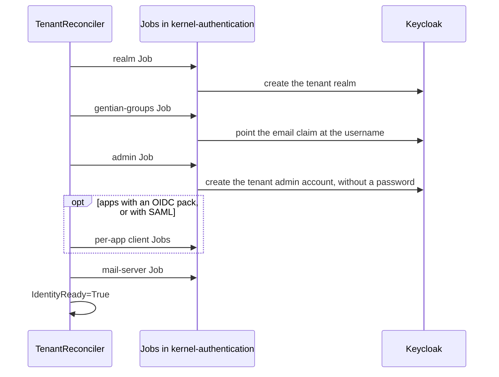

# Identity and Access Management (IAM)

This document describes identity, roles, and access control in Gentian OS.

**Companion docs:**
- [admin-console.md](admin-console.md) — the administration console
- [multi-tenancy.md](multi-tenancy.md) — namespace, network, and data isolation
- [security/design.md](../security/design.md) — Keycloak, OpenFGA, MAC layers
- [authorization.md](authorization.md) — the rights model, roles and enforcement points
- [partners.md](partners.md) — identity across clusters

---

## 1. Identity topology (Keycloak-native)

**Keycloak** holds identity and **OpenFGA**, the rights store, holds who may
do what. Identity is **Keycloak-native per tenant**: each tenant realm is the
authoritative store of that organization's accounts. A realm holds no right:
no group of it grants anything, and no token carries a `groups` claim (§1.2).

### 1.1 Realms and login

| Realm | Role |
|---|---|
| `master` | Keycloak operator CLI only |
| `kernel` | The platform's administrators, and the platform tenant's clients |
| `<tenant>` | Authoritative store of that tenant's accounts; per-app OIDC; **where the tenant's people authenticate** |

- **A tenant's people, its administrators among them,** are stored, and sign in, in the **tenant realm** — each has its own `Cookie → forms` browser flow, so there's no brokering on the sign-in path.
- The canonical, bookmarkable entry point is the tenant's desktop, **`https://desktop.<tenant>.<KERNEL_DOMAIN>/`** (on a single-tenancy cluster, `https://desktop.<KERNEL_DOMAIN>/`, §1.1a): the edge sends the browser to the tenant realm's form, which asks for email and password together.
- What the cluster's bare domain does (the apex; `www` leads where it does) depends on the cluster's tenancy mode (§1.1a). On a **multi-tenancy** cluster it is the **concierge**, a page the platform tenant publishes with no session in front of it. It asks for the email only and sends the browser to the desktop of the workspace the address belongs to (`@<tenant>.<KERNEL_DOMAIN>`, `@<KERNEL_DOMAIN>` for the platform's own people, or a tenant's custom domain); an address it cannot place is asked for the workspace's name. It asks the server nothing about accounts, and hands the address on as `login_hint`. On a **single-tenancy** cluster nobody is asked anything: the bare domain leads to the one user tenant's desktop.
- **The edge keeps the session**, not the app and not the desktop: on every host behind a session the Gateway runs the code flow against the zone's client (`gentian-edge-<zone>`), keeps the tokens in encrypted, host-scoped, `SameSite=Lax` cookies, renews them with the refresh token, and only then asks the bouncer whether this person may reach the host. The order, what the bouncer is shown and what it refuses are in [routing.md §4.1](routing.md).
- **Signing out** is `/oauth2/logout` on the host the person is on: the Gateway drops that host's cookies and sends the browser to the realm's end-session endpoint with the session's ID token as the hint, so Keycloak ends the realm session without asking and returns to the host's front page, which is the realm's sign-in again. Ending the realm session is what signs the person out of the zone's other hosts, within one access-token lifetime ([routing.md §4.2](routing.md)). Ending the realm session is also what tells the apps: the realm calls each app that can be told, inside the cluster, and the app ends its own session for that person. Which apps can be told, and how long a session lasts in one that cannot, is §1.12.
- **Tenant apps** use the same tenant realm for OIDC, so the realm session created at sign-in is reused silently by every app launch — no broker hop, no second login screen.
- The **platform admin** signs in in the kernel realm, at `https://platform.<KERNEL_DOMAIN>/`; there is no tenant realm for them to be routed to. The kernel realm holds the platform's own people -- the platform tenant's, its administrators among them -- and nobody else: a cluster's users are never the kernel realm's, on a single-tenancy cluster any more than on a shared one. A tenant's administrator the cluster gives a cluster role keeps their account in their own realm (§1.1c).

### 1.1a The platform tenant, user tenants, and the two tenancy modes

Every cluster has the **platform tenant** (`Tenant/platform`). It adopts the
kernel realm instead of getting one of its own, so its people are the
platform's administrators, and it runs the platform's own components: the
desktop at `platform.<KERNEL_DOMAIN>`, the administration console at
`admin.platform.<KERNEL_DOMAIN>`, and the concierge on the bare domain. What
it runs is installed with the cluster. It takes no catalog apps and no
add-ons: the director refuses both for a tenant whose manifest names a realm
other than its own (`spec.isolation.keycloakRealm`), with a message that says
why, and the command line and the console show that message as it is. It is
never counted as a tenant for users, under either mode.

Everybody else lives in a **user tenant**: a realm, namespaces and a zone of
its own. How many there may be, and where their hosts are, is the cluster's
**tenancy mode** (`spec.tenancyMode` on the Cluster claim, asked at install):

| | `multi` (default) | `single` |
|---|---|---|
| User tenants | any number | exactly one, named `user`; any other is refused by the webhook, the reconciler and the director, with a message naming the mode |
| A user tenant's desktop | `desktop.<tenant>.<KERNEL_DOMAIN>` | `desktop.<KERNEL_DOMAIN>` |
| Its admin console, its apps | `admin.<tenant>.<KERNEL_DOMAIN>`, `<app>.<tenant>.<KERNEL_DOMAIN>` | `admin.<KERNEL_DOMAIN>`, `<app>.<KERNEL_DOMAIN>` |
| Its realm | `<tenant>` | `user` |
| Its administrator | the **tenant admin**, `admin@<tenant>.<KERNEL_DOMAIN>` | the **user admin**, `user-admin@<KERNEL_DOMAIN>` |
| The bare domain, `www` | the concierge's address form | the user tenant's desktop; or its public website, if it put one there ([routing.md §5](routing.md#5-redirects-and-url-control)) -- `<KERNEL_DOMAIN>/sign-in` then still leads to the desktop |
| `desktop.<KERNEL_DOMAIN>` | sent to the bare domain, like `www` | the user tenant's desktop |
| The platform admin | `admin@<KERNEL_DOMAIN>`, kernel realm, at `platform.<KERNEL_DOMAIN>` | the same |

No app may take the label `console`: people may type it, so it is kept free
([routing.md §3.1](routing.md)).

On a single-tenancy cluster the user tenant has no domain of its own: its base
domain is the cluster's. Two things follow.

- **Two realms share one address space.** The platform's people (kernel
  realm) and the user tenant's (realm `user`) both have `@<KERNEL_DOMAIN>`
  addresses. The platform admin is `admin@<KERNEL_DOMAIN>` and stays so -- the
  installer creates the account under that name and looks it up by it when it
  issues an activation link (§1.4) -- so the user tenant's first administrator
  is `user-admin@<KERNEL_DOMAIN>`. Nothing stops an
  administrator of either realm from creating a person whose address exists in
  the other; the two accounts are separate, and they share a mailbox
  ([multi-tenancy.md §3](multi-tenancy.md)).
- **Some names are the kernel's.** `id`, `platform`, `www`, `argocd`,
  `headlamp`, `llm`, `mail`, `imap` and `mail-egress` directly under
  the cluster's domain are the kernel's or the platform tenant's. A component
  or an app of the user tenant whose host label is one of them is refused,
  with a `HostReserved` condition that lists them, and nothing of it is
  installed or routed.
  The platform's own names in a tenant (`desktop`, `admin`, `store`, and the
  names a sign-in page would have) are refused to apps under either tenancy
  mode ([routing.md §3.1](routing.md)).

Under `multi` a tenant named `user` is an ordinary tenant, at
`<label>.user.<KERNEL_DOMAIN>`.

**Changing the mode.** `single` to `multi` is always fine. `multi` to `single`
on a cluster that carries a user tenant other than `user` is refused by the
director before anything is written, naming the tenants in the way. Where the
claim is changed some other way, the operator holds each such tenant on its
next pass: it provisions nothing more for it and says why on its status
(`TenancyConstraint`), and removes nothing -- its namespaces, data and routes
stay as they were. The operator reads the mode when it starts.

### 1.1b Sign-up: a tenant whose accounts people make themselves

Every account above is made by an invitation. One kind of tenant is for
people nobody invites: the customers of an organization whose apps serve the
public, with an account each. Such a tenant is created with sign-up on
(`kubectl gentian tenants create <name> --self-sign-up`, `spec.signUp.enabled`
on the Tenant; the CLI says what it opens before it asks the director). It is
off for every other tenant, and a tenant made without it composes exactly as
it did before the setting existed.

What sign-up changes, and only in that tenant's realm:

- **The realm takes registrations.** The address is the login
  (`registrationEmailAsUsername`), two accounts cannot share one, and the
  account is unusable until a message to the address is answered
  (`verifyEmail`). The realm sends through the cluster's mail, which is why
  the director makes such a tenant with `mail.mode: transport-only` and the
  operator mints its submission credential.
- **The registration page carries the platform's proof-of-work check**
  (`gentian-pow-captcha`, in the platform's own Keycloak extension): the
  browser finds a number whose digest with the page's salt begins with
  enough zero bits -- a second of arithmetic for a person, a cost per
  account for a script. Nothing is loaded from a third party and nobody's
  browser is profiled; Keycloak's reCAPTCHA, which sends every visitor to
  Google, is not used. The challenge is bound to the registration it was
  made for by the authentication session, so an answer serves one sign-up.
  The flow is the tenant's own (`gentian-registration`), since Keycloak
  refuses to add an execution to its built-in one.
- **An account made that way holds what `spec.signUp.positions` names, and
  nothing else.** The realm's listener says the account was made
  (`user.registered`) and the operator gives those positions; an account made for a person who came in through an
  identity provider is not such an account. With none named it holds no
  position of the tenant, so it holds no relation on the platform: the
  bouncer refuses it the desktop and every app, the director and the usher
  refuse every tenant route. A position such as `customer` reaches the apps
  given to it and nothing else. The usage statistics report counts the
  holders of User, which include those of All apps, in such a tenant, not
  its realm's accounts. Making such an account a person
  of the tenant is an administrator giving it a position, as for anybody.
- **Its people can be sent home instead** (`spec.signUp.home`, an https
  address such as a website's account page). The tenant's bare domain then
  redirects there rather than to the desktop, and the bouncer answers a
  browser the store refuses at the tenant's desktop with a redirect there
  rather than the refusal page. It grants nothing: the request reaches no
  backend, and the tenant's people still reach the desktop.

- **The administrator's account carries its login as its address,
  recorded as verified.** The realm refuses an account without an address,
  and nothing is delivered to the administrator's: the tenant's mail only
  sends. For the same reason its activation link is shown, not mailed
  (`tenants activate-admin <name>` without `--recovery-email`): mailing it
  would make the recovery address the account's own, and there an address
  is the login. The registrar refuses that (`422`).

What it does not change: the realm's administrators, its edge client and
its positions are as in every tenant; the tenant's own people are still
invited; and the registrar lists every account of the realm, which is how
staff look after the customers' accounts.

### 1.1c Brokering: people of another realm signing in

A realm may let people of another realm — another tenant here, or a tenant of
another cluster — sign in with their own account. People of another tenant
of the same cluster are declared on both tenants (`spec.signInFrom`,
`spec.signInTo`); the operator gives each person who arrives the positions
the sign-in names, `user`, `all-apps` or positions the tenant declares,
never an administrator's. An entry with `holding` gives them only to a person who
holds one of the named positions in the source tenant, given or through a
position that includes it; it is asked at every arrival, and what the entry
gives is taken from a person who no longer holds one, whoever gave it. A
person who should keep it without the position at home is given a position
of the tenant's own for it
([identity-brokering.md](../guides/identity-brokering.md)). A realm of another cluster is Keycloak's identity
brokering: [identity-brokering.md](../guides/identity-brokering.md). The sign-in page shows
every provider not set to *Hide on login page*; the platform's own (`kernel`,
`vouch-*`) are, and so stay off it. The one brokering the platform composes
is the platform's administrators entering a tenant, below.

#### Cluster roles held by name

Every cluster role is held by a person the cluster's administrator names on
the Cluster claim, each keeping their own account in their tenant's realm --
the kernel realm for the platform tenant's people. No group of any realm
holds one. While the claim names no `admin`, the account the install made
(`admin@<KERNEL_DOMAIN>`) holds it, so a cluster is never administered by
nobody.

```yaml
spec:
  platformAccess:
    roleHolders:
      - role: perimeterApprover
        scope: tenant:acme        # follows from role and tenant
        tenant: acme
        subject: 5b1e...          # the account's id in the tenant's realm
        username: it@acme.example
        email: it@acme.example
        reason: approves acme's public addresses and egress
        expiresAt: 2027-06-30T00:00:00Z   # optional
```

| Role | Relation | Who may be named | Scope |
|---|---|---|---|
| `admin` | `admin` (`can_configure`, `can_deploy_tenant`) | a person of the platform tenant | `cluster` |
| `breakGlass` | `break_glass` (`can_set_admission`, `can_edit_raw`) | a person of the platform tenant, with a reason and until a time | `cluster` |
| `securityOfficer` | `security_officer` (`can_approve`) | a person of the platform tenant, or an administrator of another tenant | `cluster` |
| `auditor` | `auditor` (`can_audit`) | the same | `cluster` |
| `serviceAdmin` | `service_admin` (`can_operate_system`) | a person of the platform tenant | `cluster` |
| `sharedAppsAdmin` | `shared_apps_admin` (`can_install_shared`, `can_grant_shared`) | a person of the platform tenant | `cluster` |
| `perimeterApprover` | `perimeter_approver` (`can_expose`, `can_approve_privilege`) | a person of the platform tenant: every tenant | `cluster` |
| | | an administrator of tenant `t`: that tenant | `tenant:<t>` |
| `tenantAuditor` | `auditor` on the tenant (`can_read_evidence`) | a person of the platform tenant: the one tenant the entry names, never the platform | `tenant:<t>` |

The scope follows from role and tenant (`authz.HolderScope`); the claim states
it so a reader sees how far the role reaches, and an entry stating another is
refused. A `tenantAuditor` is the exception (`authz.EntryScope`): it reads one
tenant's audit evidence from the platform tenant's console, so it is held by
an account of the platform's realm -- commonly given to that tenant's
administrator for the purpose -- and the entry names the tenant, which has to
be stated. Keyed like every entry, one account audits one tenant. A person of a tenant other than the platform's must be one of its
administrators: a tenant's administrators can take over any account of their
realm, so a role held there is in their hands too, and only approving and
reading are acceptable for that. An entry is keyed by role, tenant and subject, which outlives a changed
address; `username` and `email` say who it is to a person reading the claim,
`reason` why they hold it. An entry whose `expiresAt` has passed grants
nothing: the operator projects no tuple for it and requeues at the next
expiry. Nor does the entry of a person of another tenant while they do not
administer it as the store holds it: the entry stays in the claim,
the operator logs once that it is not in effect, and the role holds again
once they are an administrator (at the next projection, at most ten minutes
on). The director's list says of each entry that is not in effect why
(`notInEffect`: `expired`, or `no longer an administrator of <t>`).

The cluster's administrator writes an entry through the director
(`can_configure`), from the command line
(`kubectl gentian platform-roles holders add <role> <tenant> <login> --reason <why> [--expires <RFC 3339>] [--scope tenant:<t>]`)
or from the platform console, whose picker lists the candidates -- every
person of the platform tenant and the administrators of each other tenant,
read by the registrar across the realms it holds a credential for,
under `can_configure` on the cluster
(`GET /v1/clusters/{c}/role-candidates`). The director refuses an entry
without a reason, one already expired, and a person of another tenant who
does not administer it as the store holds it.

**The tuple names the realm.** The operator writes each entry into the graph
directly, with the cluster's other role tuples and declaratively like them:
`user:<realm>/<subject> <relation> cluster:<c>` for scope `cluster`, and
`user:<realm>/<subject> perimeter_approver tenant:<t>` (or `auditor`) for
scope `tenant:<t>`, where `<realm>` is the holder's tenant's realm. Removing the entry
removes the tuple. Nothing is made in Keycloak, in either realm.

**Only that realm's token matches it.** Every enforcement point -- the
director, the usher, the custodian, the registrar and the edge bouncer --
asks for a caller as `user:<sub>` first and, when that is refused, as
`user:<realm>/<sub>` (`authz.CheckAs`), with `<realm>` the realm whose keys
verified the token (the issuer they accept is `<base>/realms/<realm>`, §1.1).
A subject never contains `/`, so no plain `user:<sub>` is ever a holder, and
the same subject signed in by another realm asks as another user. The holder
signs in to their own tenant as always and uses the role from its console.
Their realm's sign-in policy is the one that protects the role.

**The registrar does not touch a platform-tenant holder's account.** The
cluster's administrator manages the kernel realm's people, so the registrar's
guard (`ErrProtected`) refuses every write to a person of the platform tenant
the claim names -- their names, address, whether they may sign in, removal,
second factor, mailed password links, activation and vouching links. The
cluster's administrator cannot take over the security officer's account.

**The cluster's own tools read the roles from the token.** The vault, the
Kubernetes API's proxy, Argo CD and Grafana cannot ask the rights store, so
the kernel realm's tokens for them carry `gentian_cluster_roles`: the
cluster roles the person holds, by the model's names (`admin`, `auditor`,
...). The platform's mapper in Keycloak asks the store for every token
(§1.8). A role that is taken away stays in a token already issued until it
expires.

#### The platform's administrators entering a tenant

A tenant's administrators may grant the platform's administrators access to
their tenant:
`spec.platformAccess.adminsEnter` on the Tenant manifest, off by default,
written by the tenant's own administrators through the director
(`can_administer`), from the command line
(`kubectl gentian tenants platform-access <tenant> on|off`) or from the
switch *Platform administrators may enter this tenant* on the tenant
console's *Security* screen. When it is on, the tenant's realm composes the
identity provider `kernel`, and the kernel realm the client `broker-to-<t>`
it authenticates to, by the JWT the tenant's realm signs, checked against its
published keys -- no secret crosses. The provider requires the token's
`gentian_cluster_roles` claim to name `admin`, so no other kernel account
gets an account in the tenant through it. The realm tells the operator that
the person arrived, and the operator gives the account the position Tenant
administrator; it takes the position back from everyone who was given it
this way when the switch goes off. The realm tells after the sign-in, so the
first page of a person's first arrival may be refused. An assertion towards
a partner says such a person is a cluster administrator
([partners.md §2](partners.md)). The person arrives as
a new account of the tenant's realm, under Keycloak's own first-broker-login
flow; an address the realm already has is linked only once its owner confirms
it. The provider is hidden on the tenant's sign-in page: the way in is the
*Enter tenant* action in the platform console, which is
`https://desktop.<tenant domain>/?kc_idp_hint=kernel`. The tenant realm's
login events record each entry as a sign-in through `kernel`. This switch is
not the tenant's `operated_by` consent ([authorization.md §3](authorization.md)): that one
lets the cluster's administrators act on the tenant through the director,
this one lets them sign in to it, and each is set and withdrawn on its own.

What a platform administrator is told when they enter a tenant this way is
what any tenant administrator sees: the account they get holds the position
Tenant administrator, like every administrator's (§1.2).

### 1.2 Roles and positions

Rights have two layers, both in the rights store
(`authz/model/v1/model.fga`).

**A role** is what a person may do on one thing: a tenant, an app, or an
add-on, which is an app of its own.

| Role | On a tenant | On an app or add-on |
|---|---|---|
| `user` | a person of the tenant: enters it, sees its desktop | uses the app |
| a declared role | | what the app's profile declares between the two (`spec.roles.declared`), such as a sales manager |
| `admin` | administers the tenant: people, apps, settings | administers the app; holds every other role of it |

`admin` is the highest role and includes all others, so an app always has
somebody who can configure it. A role on an add-on lets a person into its
base app, and the base's administrator administers its add-ons.
Administering a tenant is not administering its apps.

**A position** is a named set of roles a kind of person holds.

| Position | Holds |
|---|---|
| User (`user`) | `user` on the tenant, and no role on any app: the desktop alone. Every person of the tenant holds it |
| All apps (`all-apps`) | `user` on every installed app and add-on of the tenant, and includes User. It follows what is installed |
| App administrator (`app-administrator`) | `admin` on every installed app |
| Tenant administrator (`tenant-administrator`) | `admin` on the tenant, and no role on any app |
| a tenant's own (`spec.positions`) | the roles it names, and those of the positions it includes: an executive includes the sales manager |

A person is given positions, and may be given a single role beside them as
a visible exception. An app reaches people through the positions it is
given to (`spec.apps[].positions`, at install or in the console's position
grid) and through All apps. There is no install "for everyone":
`spec.apps[].defaultGrant`, `spec.apps[].addonGrants` and an app given to
User are accepted and give nothing.

**Who writes what.** What a position is, is declared in git with the tenant
and written by the director as a commit. Who holds a position or a role is
in the rights store alone: a tenant's administrator gives and takes it in
the administration console, through the registrar, and the operator writes
it -- the operator is the store's one writer. Three things give positions
without an administrator: an account made on the registration page
(`spec.signUp.positions`, §1.1b), an arrival from another tenant
(`spec.signInFrom`, §1.1c), and a component the tenant names in
`spec.positionGivers`, which gives and takes exactly the positions named
for it there, through the registrar with its own key, whose Secret then
carries the registrar's address (`REGISTRAR_URL`)
([custom-catalogs.md](../guides/custom-catalogs.md)); the tenant whose
positions are given is the one that consents. None of the three gives or
takes a position that holds `admin` on the tenant or on an app, itself or
through a position it includes: the tenant's admission refuses one named
there, and the operator and the registrar refuse it when it is given.
Administering is given by an administrator. A tenant's last administrator
cannot lose the position. The tenant's first administrator is given it by
the operator, once.

**Taking ends sessions.** A token carries what its person held when it was
written. So whenever something is taken from a person -- directly, by a
change of what a position holds or includes, by a position no longer
declared, or by the sign-in (`signInFrom[].holding`) -- the operator ends
their sessions in the realm, and the next sign-in carries what they hold
now (§1.8). A role on an app that is uninstalled ends no session. What is
given takes effect at the next sign-in.

**Who administers gives a second factor.** The account of whoever
administers a tenant or the cluster carries a mark the realm's sign-in flow
reads (`gentianRequiresMFA`). The operator writes it from the rights store
and takes it off anybody else; the person can neither see nor change it.

**How rights are checked.** The front door asks `can_use` on an app for
every request ([routing.md §4.1](routing.md)); the platform's own services
ask the store for each call ([authorization.md](authorization.md)). What a
person holds, and through which position, is shown on the console's *Access*
screen.

### 1.2a The registrar's rights routes

What a person holds is given and taken at the registrar, which asks the
operator to write it. A person's token opens the first three, under
`can_manage_users` on the tenant; a component's key the last two
(`RIGHTS_CHECK_KEY` from its Secret `rights-check-<profile>`, which then also
carries `REGISTRAR_URL`).

| Route | Body | Answer |
|---|---|---|
| `POST /v1/tenants/{t}/actions/give` | `{"person", "position"}`, or `{"person", "app", "role"}`; `{"person", "role"}` for a role on the tenant | `200 {"person", "changed", "holds": true, "position"` or `"app", "role"}`, with `"totpRequired": true` when the person now administers |
| `POST /v1/tenants/{t}/actions/take` | the same | the same, `"holds": false`; `409` for the tenant's last administrator |
| `GET /v1/tenants/{t}/people/{id}/assignments` | | `200 {"tenant", "person", "assignments": [{"position"}` or `{"app"?, "role"}]}`: what was given, not what follows |
| `POST /v1/tenants/{t}/actions/give-position` | `{"person", "position"}` | as `give`; `403` unless `spec.positionGivers` of `{t}` names the component with that position, and for a position that administers |
| `POST /v1/tenants/{t}/actions/take-position` | the same | as `take`, with the same refusals |

A person, position, app or role the tenant does not have is `404`, the
store out of reach `502`. A take ends the person's sessions; a give takes
effect at their next sign-in (§1.2).

### 1.3 What each kind of person sees

| Who | Holds | Desktop |
|---|---|---|
| **A person of the tenant** | User, and All apps or a position of the tenant's own | The tiles of the apps they hold a role on |
| **Tenant administrator** | Tenant administrator | The administration console; an app's tile only with a role on that app |
| **Perimeter approver** | Tenant administrator, and named on the Cluster claim (§1.1c) | Approves what the tenant publishes to the internet (`can_expose`) and its egress beyond the baseline (`can_approve_privilege`), and nothing else beyond the tenant administrator's. A perimeter approver of the platform tenant approves for every tenant, and so does the cluster's administrator, by default ([security/design.md §2.14](../security/design.md)) |
| **Cluster administrator** | `admin` on the cluster, by name (§1.1c) | The platform console |

People are invited and given positions in the [administration console](admin-console.md).

### 1.4 Bootstrap credentials

| Principal | Login email | Password source |
|---|---|---|
| Platform admin | `admin@<KERNEL_DOMAIN>`, in the kernel realm | Set by its holder through a single-use activation link, which the installer issues (`./install.sh --activate-admin` for a new one). Never stored or printed |
| Tenant admin | The address on the tenant's `status.adminEmail`: `admin@<tenant-domain>`, both the username and the address; `user-admin@<KERNEL_DOMAIN>` for the user tenant of a single-tenancy cluster | The same, issued by the registrar: `kubectl gentian tenants activate-admin <tenant>` |

The link is mailed to a recovery address or shown once (see [commands.md](../reference/commands.md)).

**No administrator's password follows the cluster's `secretMode`.** It is
neither derived from the master password nor drawn at random: the account is
created without a password, in both modes, and the only password it ever has
is the one its holder sets through the link. Nothing can recompute it and
nothing holds a copy, so it does not depend on the account's name, on the
master password or on the vault.

What does follow `secretMode` is the credential the link is issued with. The
installer issues the platform admin's link as Keycloak's own bootstrap
administrator (user `admin` in the `master` realm, Secret
`keycloak-idp-credentials`, vault path
`gentian-os/kernel/identity/keycloak-bootstrap`). That password is a machine
credential like every other kernel one: with `secretMode: derived` it is
computed from the master password and the cluster's salt, and with
`secretMode: random` it is drawn once and the vault holds the only copy.

Machines sign in to the `master` realm as service accounts of their own:
`gentian-operator` (the operator), `keycloak-provisioner` (the Jobs that
configure realms) and `provider-keycloak` (Crossplane's provider). Only the
installer makes and repairs them, as the bootstrap administrator: each holds
the `admin` role, mapped into its token's scope rather than through "Full
scope allowed", and the `kc-admin-api` client scope, without which the Admin
REST API refuses its token. Its secret is kept beside that password, in the
same vault path and under the same `secretMode`. The registrar's client in a
tenant realm carries `kc-admin-api` too; the operator assigns it.

**Recovery** is a new link, never a recovered password:

- The platform admin: `./install.sh --activate-admin`, run on a host with
  access to the cluster. It needs nobody to be signed in. It reads Keycloak's
  bootstrap credential from the cluster, looks the account up by its name
  (`admin@<KERNEL_DOMAIN>` in the kernel realm) and issues a link even when
  the account already has a password; following it sets a new one and, where
  the platform tenant requires it, a second factor.
- A tenant admin: `kubectl gentian tenants activate-admin <tenant>`, by
  somebody who may configure the cluster.

**The invitation of a new tenant's admin.** A new tenant takes minutes to
exist, and its admin account cannot be activated before it does. Whoever
creates a tenant in the admin console and gives the admin's recovery address
does not have to wait: the console hands the address to the registrar, and the
registrar sends the invitation when the tenant is ready.

- The request is
  `POST /v1/clusters/{c}/tenants/{t}/actions/request-admin-invitation` with
  the address. It needs what activating a tenant admin needs — the right to
  configure the cluster — and the tenant does not have to exist yet. The
  registrar answers at once.
- The registrar keeps the request in its own database: the tenant's name, the
  address, who asked, what allowed them to, and when. This is personal data,
  and it is the only place the address is kept until the invitation is sent:
  it is not written to git, to the Tenant, to a ConfigMap or to a log.
- There is one request per tenant. A second one replaces the first.
- Every 30 seconds the registrar tries the requests it keeps. As soon as the
  tenant exists, the registrar holds the credential for its realm and the
  admin account is there, it does what `activate-admin` does with an address:
  the address becomes the account's recovery address and Keycloak mails the
  activation link to it. Then it deletes the request and records that the
  invitation was sent.
- A request waits for 24 hours at most (`REGISTRAR_INVITATION_EXPIRY`). After
  that it is deleted and recorded as expired, and nothing is mailed. So the
  address is kept for 24 hours at most.
- If the realm cannot send mail when the tenant is ready, no link is issued:
  there is nobody to show it to. The address stays on the account as its
  recovery address, the request is deleted, and the record says it could not
  be mailed, with the reason Keycloak gave. The admin is then activated by
  hand, from the console or the command line.
- If the account holds a platform role, the registrar refuses as it does for
  `activate-admin`; the request is deleted and recorded as refused.
- `GET /v1/clusters/{c}/tenants/{t}/admin-invitation` answers the state of a
  tenant's request — pending, sent, expired, not mailed, refused or none — and
  `GET /v1/clusters/{c}/admin-invitations` lists the tenants with a pending
  one. Neither answers the address. Both need the right to configure the
  cluster.
- A request without an address is not accepted: the link would have to be
  shown to a person, once, and that is what `activate-admin` does.
- A registrar without a database refuses the request, and the admin is
  activated by hand once the tenant is ready.

When Keycloak cannot send an activation mail, the registrar passes on what
Keycloak answered — the HTTP status and its message, on one line, with
anything that looks like an address or a link removed — and logs it as a
warning.

### 1.4a A person's own account

The desktop's account panel holds no right of its own. It relays the person's
token to the registrar, which acts on the token's subject and nobody else,
with a token of the tenant's realm only (`internal/registrar/account.go`):

| What | Route |
|---|---|
| Read names, address, username, second-factor state | `GET /v1/tenants/{t}/account` |
| Change first and last name | `POST /v1/tenants/{t}/actions/update-own-profile` |
| List sessions, the caller's own marked | `GET /v1/tenants/{t}/account/sessions` |
| End one session, or every one but the caller's | `POST …/actions/end-own-session`, `…/actions/end-own-other-sessions` |
| Device passwords | [bridges.md §4.2](bridges.md) |

- **The address is not changed here.** It is where a password link and a
  second-factor link are sent, so whoever could change it could take the
  account over; the tenant's administrators change it (*Members*).
- **The password is not changed here.** The realm's own pages do that: at
  sign-in, and through the link *Forgot password* or an administrator sends.
- A holder of a platform role is not renamed through the registrar (§1.1c);
  ending their own sessions is allowed.
- Keycloak's own account API is not used: it takes only a token made out to
  its `account` client, and no token of the edge is.

### 1.5 User attributes

| Attribute | Purpose |
|---|---|
| `email` / `username` | Primary login id (email) |
| `gentian.inviteEmail` | Secondary email for invite, password reset, recovery |
| `gentianRequiresMFA` | The mark the sign-in flow reads: this account gives a second factor (§1.2). Written by the operator; administrators of the realm alone see it |

### 1.6 App access and what the desktop shows

Who may use an installed app is whoever holds a role on it (§1.2). There is
no other grant, and nothing a store states gives access.

- **Giving an app.** At install the tenant's administrator chooses the
  positions that get the app (`Tenant.spec.apps[].positions`); each holds
  `user` on it. A single person is given a role on the app directly, in the
  administration console.
- **The model.** The operator writes each installed app, its add-ons and
  the roles its profile declares into the store
  (`internal/director/authz/apps.go`), and each position's roles
  (`positions.go`). `can_use` is holding any role on the app or on one of
  its add-ons; `can_launch` is `can_use`; `can_administer` is `admin`
  (`authz/model/v1/model.fga`).
- **The front door** asks `can_use` on every request to the app's host
  ([routing.md §4.1](routing.md)).
- **The desktop** shows the tiles the usher answers for the signed-in person:
  each tile names a relation and an object, and the person holds it or the
  tile is not listed. An app's tile asks `can_launch` on the app; an
  administration tile asks `can_administer` on the tenant.

### 1.7 OIDC packs (tenant realms)

An app whose OIDC client needs its own client scope, protocol mappers or a
client role declares them in an **`OIDCPackCatalog`** (cluster-scoped). It
travels in the app's profile bundle, named `<profile>-oidc`, and only a
catalog of the whole cluster may bring one.

A pack is looked up by the profile's `requires.services.identity.oidc.clientId`,
or by `oidcPackRef` where that is set. For an app with a pack the tenant's
identity provisioning runs a Job that creates the client, the scope and its
mappers in the **tenant realm**. An app without a pack gets its client
rendered with its release by the operator.

A pack with `serviceClient: true` registers a confidential client for a
service that only validates tokens (`gentian-dovecot`); it has no scope or
role.

The tenant realm keeps Keycloak's built-in `browser` flow, so it
authenticates its own people with a credential form. A tenant realm carries
the identity provider `kernel` only where the tenant switched it on
(`spec.platformAccess.adminsEnter`, §1.1c), and then for the platform's
administrators alone; its own people never reach it through the kernel realm.

### 1.8 Roles inside apps

The platform does not create, change or remove a person's account in an app.
An app makes the account when the person first signs in to it, from the token
or assertion of that sign-in. There is no event bus and no SCIM delivery.

What an app is told is **which roles the person holds on it**. A profile
declares what each role is called inside the app (`spec.roles`: `user`,
`admin`, and the declared roles, each with its in-app names); an add-on
declares its own, and they reach the app it is activated in.

- **The sign-in token.** The platform's mapper in Keycloak
  (`gentian-app-roles`) asks the rights store, through the usher, for every
  token it writes. On the app's own client, where the profile gives at least
  one role an in-app name, it writes two claims: `gentian_app_roles` (or the
  claim the profile names), the in-app names of the roles held, and the same
  name followed by `_mapped`, every in-app name the platform decides. The app
  gives the first and takes the rest of the second; what is in neither is the
  app's own. A token the front door exchanges for the app (`exchangeToken`)
  carries `gentian_app_roles` in the platform's names: `user`, `admin`, the
  declared roles, and an add-on's as `<add-on>/<role>`. When the store
  cannot be asked, a sign-in fails; a renewed token keeps the roles of the
  one before. The app author's view is
  [app-customization.md §1.2](../guides/app-customization.md).
- **An app that cannot read a token.** The operator hands the app's
  administrators and users, as the store names them, to the profile's sync
  Job (`spec.hooks.provisioning.syncJob`) in the tenant's namespace, and
  runs it again when what a person holds changes
  (`internal/controller/app_privilege_reconciler.go`). An app behind the
  sign-in sidecar reads the roles from the signed answer (§1.11).
- **A role that is taken away.** The front door stops a person who holds no
  role on the app at their next request. Whatever is taken, the operator
  ends the person's sessions in the realm; every app that is told of a
  sign-out (§1.12) drops its own, and the next sign-in carries the roles as
  they are. This holds however it was taken: from the
  person, from a position they hold or one it includes (a role or an
  inclusion removed, a position no longer declared), or by the sign-in when
  they no longer hold at home what `signInFrom[].holding` asks; the person
  then signs in once more. A role on an app that is uninstalled ends no
  session. An app that is not told keeps the role
  until the person signs in to it again. A role that is given takes effect
  at the next sign-in.

The mapper is an internal interface of Keycloak and is the platform's to
keep working across its releases.

### 1.9 Tenant identity provisioning sequence

A tenant's realm is provisioned through the `tenant-default` Composition:
partly as `provider-keycloak` resources it declares, partly as Jobs that call
the Keycloak Admin API. The operator builds the Jobs' manifests
(`internal/controller/identity_reconciler.go`, `keycloak_*.go`, helpers in
`internal/keycloak/shell_helpers.go`), hands them to the Composition in a ConfigMap,
and the Jobs run in `kernel-authentication`.



Job names follow `{purpose}-{tenant}` (e.g. `keycloak-gentian-groups-demo`).
The reconciler waits for each Job via `waitForProvisioningJob` before
advancing. The zone's sign-in client (`gentian-edge-<zone>`), its scopes and
mappers are not Jobs: the Composition declares them. The platform tenant
adopts the kernel realm and gets only the `keycloak-gentian-groups` Job.

The mail-server Job (`keycloak-tenant-smtp-<tenant>`) writes the realm's
`smtpServer` with its password. The Composition declares the same block from
`spec.realmMail`, which the operator states once the Secret holding the
password exists; a tenant it states none for has neither the block nor the
Job. Which login a realm uses in each mail mode, and what Keycloak does with
a mail server written without its password, is in [mail.md §5d](mail.md).

A tenant realm states `loginWithEmailAllowed` in both cases: `false`, and
`true` where people sign up with their address as the login.

**The manifest bridge.** The Jobs reach the Composition this way: the
operator seeds credentials in OpenBao and builds the Job manifests in Go,
writes them to the ConfigMap `tenant-{name}-provisioning-jobs` (`jobs.json`)
in `kernel-provisioning`, and `tenant-default` emits one
`kubernetes.crossplane.io/Object` per Job. A Job's pod template is immutable,
so the operator stamps each Job with a hash of its script and removes a
finished Job whose script changed; the Composition then creates it again.
`tenant-default` runs `function-sequencer`: objects that need the realm are
held back until what they depend on is Ready.

What is declared and what is a Job:

| Declared in `tenant-default` | A Job |
|---|---|
| The zone's sign-in client (`gentian-edge-<zone>`), its scopes and audience mappers | `keycloak-realm-{tenant}`: creates the realm |
| The token-exchange client (`gentian-edge-exchange`), the user profile, realm events | `keycloak-gentian-groups-{tenant}`: the realm's email claim, read from the username |
| The sign-in flow that asks a marked account for a second factor | `keycloak-admin-{tenant}`: the tenant administrator's account, without a password |
| The realm's required actions | OIDC client Jobs, for an app whose client has an OIDC pack (§1.7); SAML client Jobs |
| `gentian-dovecot` and the `mailbox` scope, where the cluster has its own mail server | `keycloak-tenant-smtp-{tenant}`: the realm's mail-server settings, where the cluster has SMTP credentials |
| The realm itself, adopted by name | |
| For a tenant people sign up to (`spec.signUp.enabled`): the realm's registration settings, its registration flow with the platform's proof-of-work check, and the binding of the realm to that flow | |
| For a tenant that lets the platform's administrators enter (`spec.platformAccess.adminsEnter`): the identity provider `kernel` (§1.1c) | |
| For the platform tenant: per entering tenant the client `broker-to-<t>` in the kernel realm | |
| A tenant's partners: the partner client and scope, the identity provider `partner-<name>` ([partners.md](partners.md)) | |

An app without a pack gets its OIDC client rendered with its release by the
operator (`internal/apprender`), not from a Job; the tenant reconciler only
seeds the client's secret. The platform tenant adopts the kernel realm: it
gets no realm Job, no administrator Job and no mail-server Job, and the clients the platform's administrators enter other tenants
with, which are declared.

**Deleting a tenant.** The operator runs one Job
(`internal/controller/identity_reconciler.go`): it deletes the realm where
the tenant's `spec.deletionPolicy` is `Delete`, and otherwise disables it.
The kernel realm is never touched. The composed Keycloak objects have
`deletionPolicy: Orphan`: they are not deleted one by one, they go with the
realm.

Rendered Compositions are tested under `crossplane/tests/unit/render/`; the
Jobs of a tenant are listed with
`kubectl get jobs -n kernel-authentication -l gentianos.io/tenant=<name>`.

---

### 1.10 Keycloak version, features and upgrades

**Version.** Keycloak 26.8.2, from the `keycloakx` chart 7.3.2. The chart is
vendored under
[kernel/services/keycloak-idp/manifests/charts/](../../kernel/services/keycloak-idp/manifests/UPSTREAM.md)
and rendered by Argo CD from the identity ApplicationSet; the image tag in
`keycloakx.image.tag` ([values.yaml](../../kernel/services/keycloak-idp/manifests/values.yaml)),
because the chart trails upstream; the event listener is compiled against the
same version (`keycloak.version` in its `pom.xml`). The three move together.
`provider-keycloak` stays at v2.19.0.

**Features.** Nothing is switched on or off, so the release's defaults apply.
What 26.8 enables that 26.0 did not is inert until something asks for it:

| Feature | Stays off because |
|---|---|
| Standard token exchange, proof-of-possession (DPoP) tokens | per client. `standard.token.exchange.enabled` is set on the edge's exchange client and on the client of a component that declares `requires.services.vouching.exchange`; no client the platform creates sets `dpop.bound.access.tokens` |
| SCIM API, fine-grained admin permissions v2 | per realm (`scimApiEnabled`, `adminPermissionsEnabled`), false in every realm the platform creates |
| JWT authorization grant, federated client authentication, Kubernetes service-account sign-in | need an identity provider or client authenticator configured for them; none is |
| Passkeys, update-email, workflows, client secret rotation | per realm policy, required action or client policy; none is configured |
| Recovery codes | the browser flow of a new realm lists them as disabled, so sign-in does not accept them and the account console does not offer them; only the required action exists |

**The API's audience is a custom audience.** `gentian-director` names the
platform's API, and no Keycloak client has that name. An audience mapper must
therefore use `included.custom.audience`: from 26.8 Keycloak leaves out an
audience that names a client which is absent or disabled, and the token then
carries no audience and every API call is refused.

**A mailed link verifies an address only if it says so.** From 26.8 an
admin-sent action link marks the address verified only when it names
`VERIFY_EMAIL`. Invitations and mailed activations name it; an activation link
that is shown instead of mailed does not, so that account's address stays
unverified.

**Token introspection checks the audience.** From 26.6 a client may introspect
only tokens that name it in `aud`. Dovecot validates an XOAUTH2 token by
introspecting it as `gentian-dovecot`, so a mailbox opens only for a token that
names `gentian-dovecot`, and which tokens do is declared:

- Each tenant realm on a cluster with its own mail server has the client scope
  `mailbox`. Its one mapper adds `gentian-dovecot` to the audience of an access
  token (`included.client.audience`: Keycloak leaves it out if that client is
  disabled or gone). Nothing else in the realm names that audience.
- The scope is an *optional* scope of the client of a profile that declares
  `requires.services.mail.imap.tokenSignIn`, and of no other client. A token
  carries the scope and the audience only when such an app asked for `mailbox`
  at that sign-in, or such an agent bridge at the exchange of the token the
  chaperone handed it, which names the bridge; Keycloak refuses the request of
  a client without the scope (`invalid_scope`).
- Dovecot requires the scope too (`scope = mailbox` in each realm's oauth2
  settings), opens the mailbox of the token's `email` claim, and refuses a
  mail program that names another address.

`gentian-dovecot` does not carry the client attribute that switches the audience
check off for it. The kernel realm has no `mailbox` scope, so no token of the
kernel realm opens a mailbox; app passwords are unaffected everywhere. Who may
do what with such a token: [security/design.md §2.16](../security/design.md).

**Upgrading an existing cluster.** Keycloak migrates its database on first
start of the new version, and the migration is one-way: 26.0 cannot run on a
26.8 database, so going back means restoring the database.

1. Back up the `keycloak` database (and take the tenant exports).
2. Upgrade: replace the vendored chart and the image tag (UPSTREAM.md says
   how) and let Argo CD sync `keycloak-idp-<stage>`. Keycloak is one replica,
   so sign-in is down while the pod restarts and migrates.
3. Verify: the pod is Ready, a person can sign in, the console lists people,
   and a tenant's Keycloak objects are Synced.

Sessions are kept in the database and survive the restart. Re-run the installer
step that configures the kernel realm once: it rewrites the CLI client's
audience mapper. 26.5 dropped PostgreSQL 13; the kernel's PostgreSQL is newer.

### 1.11 How a person gets into an app: three ways

Every app is behind the front door, which checks the session and whether this person may use this
app ([routing.md §4.1](routing.md)). What differs is how the app itself then learns who is there.
A profile says which, under `requires.services.identity`, and states exactly one:

| | The profile declares | Who speaks to the realm | What the platform registers | Holds the app's keys |
|---|---|---|---|---|
| **OIDC** | `identity.oidc` | the app | an OIDC client of the app's own (the operator, with the release) | nobody but the app |
| **SAML** | `identity.saml` | the app | a SAML client with the address the app states (the tenant's identity Job) | nobody but the app |
| **Sidecar** | `identity.sidecar` | the platform's sign-in sidecar, beside the app | a SAML client for the sidecar, at an address the platform derives (the operator, with the release) | the sidecar: what the profile declared for its handler |

Take them in that order. OIDC wherever the edition installed offers it; SAML for an app that
offers that and no OIDC; the sidecar only for an app that can do neither, because it is the one
way in which a program beside the app can become anybody in it.

**The sidecar's sign-in, step by step.** The person is signed in at the platform already.

1. They open the app. The front door admits them, or sends them to the realm first as for any app.
2. The app's front page is one of the profile's `entryPaths`, so the Gateway answers with a
   redirect to `/sso/login` on the same host.
3. `/sso/login` is a rule of the app's own route, behind the session and the bouncer. The request
   reaches the sidecar with the bouncer's identity headers. The sidecar remembers a new request
   and the address of the person it is for, sets a cookie that marks this browser, and sends the
   browser to the realm with a SAML request.
4. The realm recognizes the person from their session and answers without asking: a page that
   posts a signed response to `https://<app host>/sso/acs`, the one address registered.
5. `/sso/acs` is a route of its own with no session, because that post comes from the realm's
   address ([routing.md §4.1](routing.md)). The sidecar checks the response
   ([security/design.md §2.12](../security/design.md)) and runs the app's handler.
6. The handler finds or makes the person's account in the app, makes it an administrator's or an
   ordinary one, and makes a session for it. The sidecar writes the response: the app's session
   cookie, or a page that puts the session where the app's own page keeps it, and a redirect into
   the app.

**Who administers an app signed in to this way** is who holds `admin` on it (§1.2). The
platform's mapper lists the person's roles on the app in the signed assertion, as the rights store
answers them, the sidecar reads them from the signed bytes, and the handler gives or takes the
app's administrator role at every sign-in. A tenant's administrator is not an app's administrator
for being that ([app-customization.md §2.3a](../guides/app-customization.md)).

An app session made this way lasts at most an hour and never longer than the realm session it
came from. When it has run out the app sends the browser to its own sign-in page, which is an
entry path again: the steps repeat without the person being asked. A person who was removed, or
lost the right to the app, is refused by the front door on their next request, whatever session
the app still holds.

No password exists for the app. The sidecar is registered per app and per tenant, in the tenant's
realm, and is removed with the app.

**When the platform runs a sidecar at all.** Only for an install pinned to a digest, whose bundle
comes from a catalog of the whole cluster and brings the handler; never from a tenant's own
catalog, and never for a tenant that signs in in the kernel realm. Otherwise the Component is
held with `SignInSidecarRefused` and says why ([security/design.md §2.12](../security/design.md)).

**What none of the three ways gives.** The identity headers an app or a sidecar receives are not
signed; network rules are what keep another pod from sending them. An app whose own page sends
a bearer token of the app's loses it on a session route, where the Gateway drops the client's
`Authorization` header, unless its entry declares `clientAuthorization: app` and the tenant's
perimeter approver approved it; sign-in stays required either way ([routing.md §4.1](routing.md)).
A client with no browser session reaches an app only through a public entry of `authMode: app`,
with a credential the app issued: the platform does not know that caller, and removing a person
from the realm does not end such a credential ([security/design.md §2.14](../security/design.md)). And a sign-out ends an app's own session
only where the app can be told of it (§1.12).

**Which way for which app.** Every address of an app is behind the same front door
([routing.md §4.1](routing.md)); what differs is how the app then learns who is there. Ask in
this order and stop at the first that applies:

| The app | Its profile declares | What the app receives | How the person experiences it |
|---|---|---|---|
| is a page of the platform itself that calls the platform's services (desktop, administration console, App Store app) | `forwardToken: true` on the entry for the page's server, allowed for `trustTier: platform` only, because the session's token is valid at the director and every sibling | the session's own token, which it passes on; each platform service verifies it and asks OpenFGA | signed in; no second step |
| verifies the person itself from a token the platform hands it | `exchangeToken: true` on the entry: the bouncer exchanges the session's token at the tenant's realm for one whose audience is the app alone (`internal/bouncer/exchange.go`); any app may ask for it | a token valid at this app and nowhere else, in `Authorization`; it need not trust the identity headers | signed in; no second step |
| can sign people in with OIDC in the edition installed | `requires.services.identity.oidc` | its own client at the realm; the realm session from the desktop answers without a form | a redirect to the realm and back, no form |
| can do so with SAML and not with OIDC | `requires.services.identity.saml` | a SAML client at the realm | the same |
| has accounts with a user name and a password, and neither | `requires.services.identity.sidecar` | the platform's sign-in sidecar beside it, which signs the person in through its handler (above) | the same |
| has pages that send the app's own token to the app's API | `clientAuthorization: app` on the entry, in effect once the tenant's perimeter approver approved it ([routing.md §7](routing.md)) | its own `Authorization` header, left as the page sent it; the session is still required | the app's own sign-in in the page, behind the platform's |
| has no accounts at all | nothing | the identity headers, or nothing it reads | the front door alone |

A program is not a person at a browser: the command line reaches the director through the API
server ([commands.md](../reference/commands.md)), and a client without a session reaches an app only
through a public entry of `authMode: app`. The rules for the catalog: every profile says how its
app signs people in, by exactly one of the three `identity` declarations, or by none for an app
without accounts; `forwardToken` and `exchangeToken` are entry settings, never a substitute for
one; and no app is given a shared account: every session in an app belongs to one person.

### 1.12 Signing out: what ends, where, and when

A person signs out once, at `/oauth2/logout` on whichever host they are on. Four things have a
session for them, and each ends differently.

| Where the session is | What ends it | When |
|---|---|---|
| **The realm** (Keycloak) | the sign-out itself: the Gateway sends the browser to the realm's end-session endpoint with the session's ID token | at once |
| **The front door** (the Gateway's cookies, per host) | the host the person signed out on: its cookies are deleted. Every other host of the zone: its access token cannot be renewed against the ended realm session | at once on that host; within one access-token lifetime elsewhere — five minutes in a tenant realm ([routing.md §4.2](routing.md)) |
| **An app that signs people in itself** (its own OIDC client) and declares where it is told | the realm posts a logout token to the app, inside the cluster; the app checks it and ends its session | at once, if the app was running when the realm told it |
| **An app behind the sign-in sidecar** whose handler can end a session | the realm posts a signed logout request to the sidecar, inside the cluster; the sidecar checks it and has the handler end the person's sessions in the app | at once, if the sidecar was running when the realm told it |
| **Any other app session** | nothing the platform does. The app's own lifetime for a session | a sidecar's app: an hour at most. An app with its own client: as long as the app keeps a session |

**When an administrator switches a person off.** There is no Sessions screen and no act that
ends somebody's session by hand. What happens:

- The registrar sets the account to disabled at the realm (`update-person`), or deletes it
  (`remove-person`). It ends no session itself and tells no app
  (`internal/registrar/identity/people.go`).
- The realm stops signing the account in and stops renewing its tokens. The bouncer asks no
  revocation question, and the rights store records no ended session. The front door keeps a
  person signed in only by renewing a five-minute access token against the realm session, so
  every host of the zone stops answering them **within five minutes**, not at once
  (`accessTokenLifespan` in `tenant-default`).
- For a removed person the rights go as well: the realm's event reaches the operator, what
  the person held is deleted, and the front door refuses the next request it asks about.
  A person who is only switched off keeps what they hold; what stops them is the realm.
- The realm posts no logout notice to the apps for either act, so a session an app holds itself
  is not ended. It is of no use behind the front door, which refuses the request first. A
  credential the app itself issued and accepts on a public entry (`authMode: app`: an app
  password, an API key) is the app's alone: the platform does not end it, and it works until the
  app or its administrator withdraws it (§1.8).

**How the realm tells an app.** Server to server, at the app's own Service inside the cluster —
never at the app's public address, where every path is behind a session and the realm, which is
not a browser, has none. Nothing is opened for it at the front door.

- *An app with its own OIDC client* says in its profile which path of which of its entries takes
  the notice (`requires.services.identity.oidc.backchannelLogout`). The platform builds the
  address from that entry's own Service and registers it with the client
  ([app-customization.md §2.10](../guides/app-customization.md)). The notice is an OpenID Connect
  logout token: a JWT the realm signs, naming the client, the person and the session.
- *An app behind the sign-in sidecar* (§1.11) declares nothing. The sidecar's client at the realm
  is registered with the sidecar's own Service as its SAML single-logout address; the realm posts
  a signed `LogoutRequest` there, and the sidecar calls the handler's `onLogout`.

**The realm tells once.** Keycloak 26.8.0 posts the notice when a person signs out or an
administrator ends their session. It does not post again if nothing answered, and it posts
nothing when a session merely runs out. So the notice shortens the common case to nothing; it
is not what bounds the worst case. The bounds are the lifetimes in the table.

**What the catalog's apps do** (gentian-apps; each *yes* is shown end to end against the app's
real image and Keycloak 26.8.0):

| App | Told of a sign-out | The session then |
|---|---|---|
| Nextcloud (`nextcloud-base-ce`) | yes, its own client | ends for the browser that signed out |
| XWiki (`xwiki-ce`) | yes, its own client | ends, every session of that person |
| Docmost, OpenProject | yes, through the sidecar | ends, every session of that person |
| Nextcloud (`nextcloud-base-od`) | declared, not shown with its own image | unknown until it is |
| Open WebUI 0.10.2 | declared, not in effect: needs a switch and Redis | lasts as long as its own token |
| Element (Synapse) | no: nothing registers an address, and Synapse's switch is off | lasts as long as Synapse keeps it |
| Mathesar, Odoo | no: neither has an endpoint for it | lasts as long as the app keeps it |

**What an outlived session is worth.** Not a way in: the front door refuses a signed-out
person's next request to every app, within the five minutes above, whatever the app remembers.
What it costs is on a shared browser: the next person, admitted by the front door as
themselves, can be shown the previous person's account by an app that still has that person's
cookie. The security side of all of this is [security/design.md §2.15](../security/design.md).

## 2. Administration UI

| Concern | Where |
|---|---|
| People, positions and app access | The administration console, `admin.<tenant domain>`: *Members*, *Positions*, *Apps*. It holds no Keycloak credential: the registrar does, one per realm, and checks the caller against OpenFGA |
| Realm password, session and lockout policy | The console's *Security* screen; a commit by the director (`can_set_policy`), applied by `tenant-default`. There is no other way to set it: the registrar's Keycloak client holds `view-users`, `query-users`, `query-groups` and `manage-users`, and no role over realm settings |
| Notices to a tenant's people | The console's *Notifications* screen |

Full description: [admin-console.md](admin-console.md).

---

## 3. MAC and IAM (layering)

IAM does **not** replace the MAC backbone:

- **MAC** — `tenant-{name}` namespace, NetworkPolicy, Kyverno ([security/design.md](../security/design.md))
- **Identity** — per-tenant Keycloak realm
- **Authorization** — OpenFGA (ReBAC): roles and positions (§1.2)

Effective access is the **intersection** of all layers.
